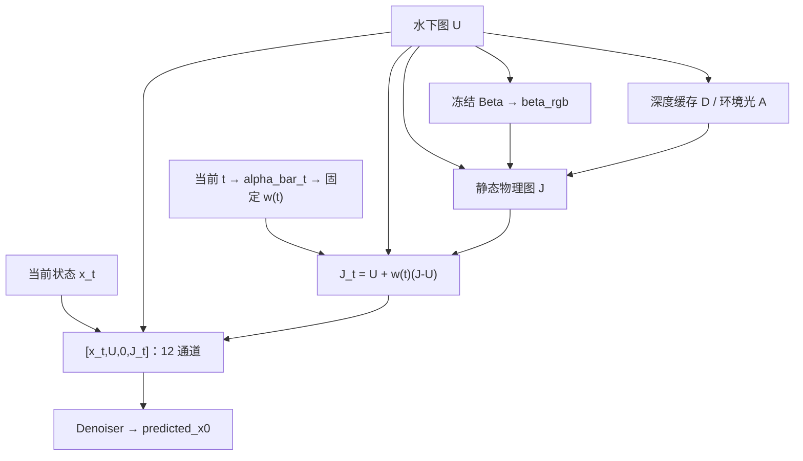

# 动态物理先验与渐进蒸馏：代码及数据流

本文按本仓库 `main` 的实现逐项说明。核对基线为 `f36416a24009d732c20804800f1b54de1860edee`，本次只增加注释和文档，未改算法、默认超参数或权重。旧服务器工程中的 `training/progressive_targets.py` 等路径已整理到本仓库的 `student/`，阅读时以这里的调用关系为准。

本文说明可执行流程；仓库没有收录历史实验结果，不能仅凭代码推导模型的质量提升、搜索位置的稳定性或实际加速倍数。

## 1. 总体链路与阅读入口


| 要读的问题 | 文件与函数 |
| --- | --- |
| CSV、图像、缓存如何进入模型 | [`data/dataset.py`](../src/seadiff_distill/data/dataset.py)：`SeaDiffDataset`、`InferenceDataset` |
| 静态物理图 J 从哪里来 | [`data/physical.py`](../src/seadiff_distill/data/physical.py)：`compute_physical_image` |
| J 如何随 t 改变 | [`teacher/conditions.py`](../src/seadiff_distill/teacher/conditions.py)：`dynamic_physical_slots` |
| 12 通道的准确顺序 | [`data/packing.py`](../src/seadiff_distill/data/packing.py)：`pack_paper_order` |
| 400k/E3 如何训练 | [`teacher/trainer.py`](../src/seadiff_distill/teacher/trainer.py)：`TeacherTrainer`；[`teacher/e3_finetune.py`](../src/seadiff_distill/teacher/e3_finetune.py)：`E3TeacherTrainer` |
| Adapter 插在哪里、如何冻结骨干 | [`models/adapter_student.py`](../src/seadiff_distill/models/adapter_student.py)：`OneStepSeaDiffStudent` |
| 各阶段顺序和轮数 | [`student/trainer.py`](../src/seadiff_distill/student/trainer.py)：`STAGE_PLAN`、`StudentDistillationTrainer` |
| 网格、教师链和反解目标 | [`student/grids.py`](../src/seadiff_distill/student/grids.py)、[`student/targets.py`](../src/seadiff_distill/student/targets.py) |
| 教师如何交接 | [`student/stage_teacher.py`](../src/seadiff_distill/student/stage_teacher.py)：`promote_stage_teacher` |
| 门控与 Adapter 的更新次序 | [`student/bilevel_optimizer.py`](../src/seadiff_distill/student/bilevel_optimizer.py)：`BilevelOptimizer.step` |
| 超梯度实际使用什么近似 | [`student/hypergradients.py`](../src/seadiff_distill/student/hypergradients.py)：`compute_bilalora_hypergradient` |
| 单步推理和导出 | [`scripts/infer_student.py`](../scripts/infer_student.py)、[`scripts/export_student.py`](../scripts/export_student.py) |

## 2. 张量、条件来源与两种 beta

训练默认空间尺寸为 336×336，下面用 H、W 表示一般尺寸；表中的 H 条件与高度 H 是不同符号。

| 名称 | 形状 | 来源及作用 |
| --- | --- | --- |
| U | `[B,3,H,W]` | 水下 RGB，FP32、[0,1]；推理时可获得 |
| GT / reference | `[B,3,H,W]` | 成对参考图；用于训练加噪与监督，推理模型输入不依赖它 |
| D / depth | `[B,1,H,W]` | U 经 Depth Anything V1 Small 生成，逐图 min-max 后缩放，缓存为 FP32 |
| H / histogram | `[B,3,H,W]` | U 的 RGB-uv 直方图条件；缓存总和为 1；E3 打包时替换为零 |
| beta_rgb(U) | `[B,3,1,1]` | `Beta_UNet(U)` 输出的逐图 RGB 物理衰减系数，不随 t 改变 |
| A(U) | `[B,3,H,W]` | `get_A` 逐图估计的空间环境光图，叠成 batch |
| J、J_t | `[B,3,H,W]` | 静态物理图、随 t 插值的动态物理图 |
| x_t | `[B,3,H,W]` | 扩散状态，与 U 是两个不同张量 |
| timesteps | `[B]`，long | 每个样本自己的日程索引，取值 0…999 |
| packed | `[B,12,H,W]` | 基础教师 `[x_t,U,H,J]`；E3/学生 `[x_t,U,0,J_t]` |
| predicted_x0 | `[B,3,H,W]` | Denoiser 直接预测的清晰图，网络不直接预测 epsilon |

请区分：`beta_rgb(U)` 是 Beta 网络的物理参数；`beta_t` 是线性扩散方差日程。`alpha_bar_t = product(1-beta_i)` 来自后者，二者不共享含义。

[`scripts/prepare_conditions.py`](../scripts/prepare_conditions.py) 只读取 U 来生成 D/H，GT 不参与条件生成。数据读取后深度不再二次 min-max。即便 E3 仍加载 histogram，其内容也会被 `zeros_like` 消去。

## 3. 动态调整物理先验的实际含义

### 3.1 先从 U 计算静态 J

`compute_physical_image` 中，单通道 D 扩展为 RGB：

```text
beta_rgb = Beta_UNet(U)
T        = exp(-beta_rgb * D_rgb)
S        = 1 - T
J_pre    = (U - S * A(U)) / T
J        = clamp(J_pre, 0, 1)
```

这里 T 是透射率，不是训练总时间步数。代码检查 beta_rgb、D 均在 [0,1]，因此透射率至少为 exp(-1)。J 不读取 GT，也不读取当前 x_t。

### 3.2 再根据当前 t 插值

`canonical_alpha_bar` 使用 CPU FP32 上的 1000 点线性日程：`beta_t=1e-6…0.02`。训练与动态条件推理共用它。

```text
w(t)   = 0.1 + 0.9 * (1 - alpha_bar_t)^2
J_t    = U + w(t) * (J - U)
H_slot = zeros_like(H)
packed = concat([x_t, U, H_slot, J_t], dim=1)
```

每个样本的 w 为 `[B,1,1,1]`，广播到 RGB 全图。它是固定时间函数，既不是可学习的门控，也不读取图像内容来决定权重。Adapter 的 sigmoid 门控是另一套参数。

沿反向采样 `999 → 0`，alpha_bar 增大，w 从约 1 降到 0.1，因此 J_t 从接近 J 转向接近 U；末端仍保留约 10% 的 J−U。不能将当前实现描述成“越接近输出，物理先验越强”。



### 3.3 训练与推理的梯度方向

| 阶段 | x_t 的来源 | 物理路径 | 更新哪些参数 |
| --- | --- | --- | --- |
| 原始 400k 教师 | `sqrt(alpha_bar_t)*GT + sqrt(1-alpha_bar_t)*epsilon`，随机 t | J 保留梯度 | Denoiser 与 Beta 联合更新 |
| E3 额外 10k 微调 | 同样由 GT 加噪，随机 t | Beta 冻结；J 在 no_grad 下生成，再构造 J_t | 只更新 Denoiser |
| 学生蒸馏 | 逐样本抽区间起点 t，由 GT 加噪 | 冻结 Beta；目标教师无梯度 | Adapter；搜索阶段另更新门控 |
| 教师/学生推理 | 初始为纯噪声；教师继续采样、学生直接输出 | no_grad | 不更新参数 |

E3 是“400k 初始化 + 10k 动态条件微调”，并非原始 400k 权重本身。Beta 重新保存后的文件 SHA 可以变化；是否冻结应看参数是否参与更新、张量内容是否一致，不能只比较序列化文件字节。

## 4. 渐进蒸馏：每个 batch 在学什么

### 4.1 初始化与阶段计划

`OneStepSeaDiffStudent` 深拷贝 E3 denoiser 并冻结其参数，在 `enc1/enc2/enc3/enc4/mid/dec4/dec3/dec2/dec1` 插入 Adapter：

```text
adapter(h) = Conv1x1_up(SiLU(Conv1x1_down(h)))
h_out      = h + sigmoid(a_site) * adapter(h)
```

bottleneck 为 C/4，升维层权重零初始化，因此初始残差为零。冻结骨干仅禁止更新其权重；学生前向仍保留反传路径，损失才能经过后续骨干层传到较早的 Adapter。

| 阶段 | epoch | 教师网格点数 → 学生网格点数 | 目标教师 |
| --- | --- | --- | --- |
| 预热 | 1–5 | 1000 → 500 | E3；门控固定 0.5 |
| S1 | 6–7 | 1000 → 500 | 原始 E3，继续预热后的学生参数 |
| S2 | 8–9 | 500 → 250 | S1 结束的冻结学生快照 |
| S3 | 10–12 | 250 → 125 | 上阶段冻结快照 |
| S4 | 13–15 | 125 → 63 | 同上 |
| S5 | 16–19 | 63 → 32 | 同上 |
| S6 | 20–24 | 32 → 16 | 同上 |
| S7 | 25–30 | 16 → 8 | 同上 |
| S8 | 31–37 | 8 → 4 | 同上 |
| S9 | 38–46 | 4 → 2 | 同上；结束时保存 stage_2 |
| S10 | 47–60 | 2 → 1 | 冻结 stage_2 |
| 固定 Top-3 微调 | 61–100 | 2 → 1 | 仍为同一 stage_2 |

数字表示网格点数，不能解释成把时间步 t 从 1000 改成 500。实际索引始终在 0…999。`build_nested_grids` 从 `[999,…,0]` 逐级取偶数下标，并替换末点保留 0；这不是对每一级重新 linspace。端点保留可能使个别学生区间覆盖超过两次教师更新。G(1) 特例为 `[999]`，其训练区间明确设为 `999 → 0`。

预热后不晋升教师；S1 仍用 E3。普通预热结束进入 S1 时会新建 AdamW，延续 Adapter 权重，但不延续预热优化器的动量。S1…S9 的边界才将当前完整学生深拷贝、固化全部九个门控、冻结并保存为下一阶段教师；快照与继续训练的学生不共享更新。

### 4.2 区间状态、教师链、反解目标

[`DistillationTargetProvider.sample_batch`](../src/seadiff_distill/student/targets.py) 对 batch 中每个样本依次执行：

1. 在当前学生网格的相邻区间中均匀随机选择 `(t,s)`；G(2) 与 G(1) 都只剩 `999 → 0` 一个区间，因此 S9、S10 和微调阶段的起终点固定。
2. 用 batch_index 派生的生成器抽 epsilon，以 GT 构造 `x_t`。
3. 教师从完全相同的 x_t 出发，运行覆盖 `(t,s)` 的父网格子链。每次教师前向都按当时的 t 重建 J_t，采用 DDIM eta=0，不另加每步随机噪声。
4. 得到教师区间终点后，反解学生一次预测应给出的 x0 目标，并 detach。
5. 学生使用同一 x_t、起点 t 与对应 J_t，一次前向预测 x0，计算 GT 重建和 KD 损失。

用 `a_t=sqrt(alpha_bar_t)`、`sigma_t=sqrt(1-alpha_bar_t)` 表示系数：

```text
x_t       = a_t * GT + sigma_t * epsilon
eps_hat   = (state_t - a_t * predicted_x0) / sigma_t
state_s   = a_s * predicted_x0 + sigma_s * eps_hat   # 教师 DDIM 更新
r         = sigma_s / sigma_t
target_x0 = (x_s_teacher - r * x_t) / (a_s - r * a_t)
```

反解分母检查为 `abs(a_s-r*a_t) >= 1e-4*r`；这是相对下界。`run_chain`、`inverse_target` 以及最终返回的目标都切断教师梯度。教师目标不是每图预存一张固定终点图，而是随阶段、抽样区间和 x_t 在线生成。

**末端实现需特别注意：**当 s=0，`run_chain` 先到日程第 0 项，再额外调用 t=0 的教师前向，把其 x0 输出作为 `x_s_teacher`；`inverse_target` 仍读取 `alpha_bar[0]` 的 a_s、sigma_s，未改成理想干净端点 `a_s=1,sigma_s=0`。本文保留该实际约定，不能把它写成已经严格满足理想端点等价性；若要改动，需单独评估算法和既有权重的影响。

### 4.3 损失和双层更新

内层用 inner480，外层用 dev120，两者都调用同一 `DistillationLoss`：

```text
L_original = mean_MSE(predicted_x0, GT) + 0.1 * VGG19_loss(predicted_x0, GT)
L_distill  = mean_MSE(predicted_x0, stopgrad(target_x0))
L_total    = L_original + 0.5 * L_distill
```

VGG19 冻结其权重；预测分支仍保留梯度。特征取 relu1_2、relu2_2、relu3_3，逐层 mean MSE 后等权平均。训练损失不先 clamp 预测结果。

当前实现对同一次学生预测同时计算 GT 和 KD 两项损失，没有独立采样 t 的额外 L_original 前向；模型类中保留的旧接口说明不能替代当前训练器的实际调用。

`BilevelOptimizer.step` 的实际顺序为：

1. 在同一参数点计算 inner 损失；需要门控更新时再计算 outer 损失。
2. 对 Adapter 参数 w 和门控 logit a 分别取梯度，用式(7)投影近似：

   ```text
   c   = <grad_w L_outer, grad_w L_inner> / (||grad_w L_inner||^2 + epsilon)
   g_a = grad_a L_outer - stopgrad(c) * grad_a L_inner
   ```

3. 裁剪门控梯度到范数 1.0，用 Adam 更新门控；随后以更新后的门控重新前向 inner。
4. 裁剪 Adapter 梯度到范数 1.0，用 AdamW 更新 Adapter。

这是 `create_graph=False` 的一阶梯度投影近似；没有可微虚拟优化器展开或 Hessian 反传。`unrolled_steps: 1` 是保留的配置项，不能用其名称推断执行了真正 unroll。

外层触发条件为 epoch 内 `batch_index % 4 == 0`，即从该 epoch 首个 batch 开始每四个一次；其余 batch 只更新 Adapter。不过当前实现仍先算 `inner_before`，再算 `inner_after_gate`，因此搜索训练通常是两次学生前向，更新门控时为三次，另有教师链开销。“单次 U-Net”仅描述部署。

## 5. Top-3、微调、导出和部署

第 60 轮将 sigmoid 门控排序，选择 Top-3，记录原始九个值、排序和辨识度到 `selection_details.json`。位置由当前训练结果决定，代码不预设 `dec2/dec1/enc2`。若门控极差小或全接近 0.5，日志会提示排名可能不稳定；一次 Top-3 排名本身不构成位置优越性的证据。

选中门控保留其原值并固定，落选 Adapter 不执行。随后在完整 600 对数据上微调选中 Adapter 40 轮，继续使用冻结 stage_2 的 2→1 目标，报告模型固定为 epoch100。dev120 此时并入训练集；测试集不进入训练器。

部署流程：

```text
U + D/H缓存 → 冻结Beta与环境光 → J → 固定t=999构造J_999
sample_id + seed → CPU确定性纯噪声 z
[z,U,0,J_999] → E3骨干 + 3个固定门控Adapter → predicted_x0
→ clamp(0,1)保存；有GT时额外计算逐图指标
```

推理不需要 GT、阶段教师或网格循环。`sample_id+seed` 的 BLAKE2b 噪声规则用于推理对比；它与训练中由 batch_index 生成 epsilon 的规则不同。

`export_student.py` 仅导出选中 Adapter、固定门控及必要元数据；仍需 E3 denoiser 和 Beta 权重，深度条件也需缓存或相应生成模型。所谓“一次 U-Net”不包含 Beta、深度和缓存准备的成本，不能据此声称完整系统只执行一个网络。

导出保留 `absorb_gates=False`，以免改变浮点乘法顺序。合成输入上的输出差值检查验证导出结构等价性，不替代真实数据质量测试。

## 6. 教师多步采样与复现边界

- 教师推理有 DDPM 和 DDIM 两条入口；DDPM 此处固定完整 1000 步、t>0 加噪，方差使用 beta_t；DDIM eta=0 的步数由参数控制。渐进目标链采用 DDIM，不能直接等同于 DDPM1000 基线轨迹。
- E3 每步重建 J_t；基础 400k 则保持 U/H/J 静态条件。两者都直接预测 x0，再由采样公式更新状态。
- 断点保存学生、优化器、RNG、global_batch_index、配置哈希和阶段教师引用/SHA 等信息，但当前未完整保存外层 dev 迭代器及 dev_batch_counter，不能承诺中途恢复后外层随机流逐 batch 完全一致。阶段末 rolling 保存还早于该阶段的教师快照晋升，直接用该 rolling 进入下一阶段可能缺少所需快照；阶段边界 checkpoint 与任意 rolling 不能混同。
- 本次注释不重训、不重跑历史实验，也不将历史报告中的指标或最佳位置当成本仓库代码的必然输出。涉及末端目标约定或严格断点复现的行为调整应另作变更并验证。
